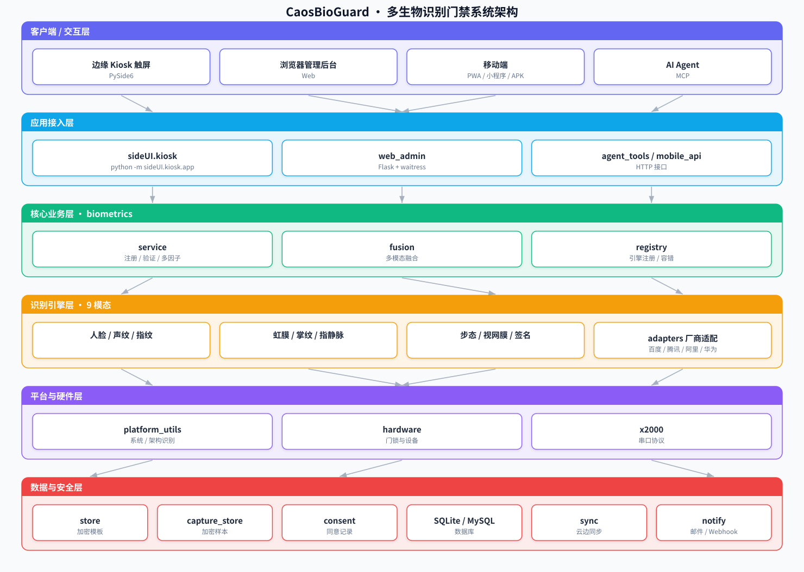
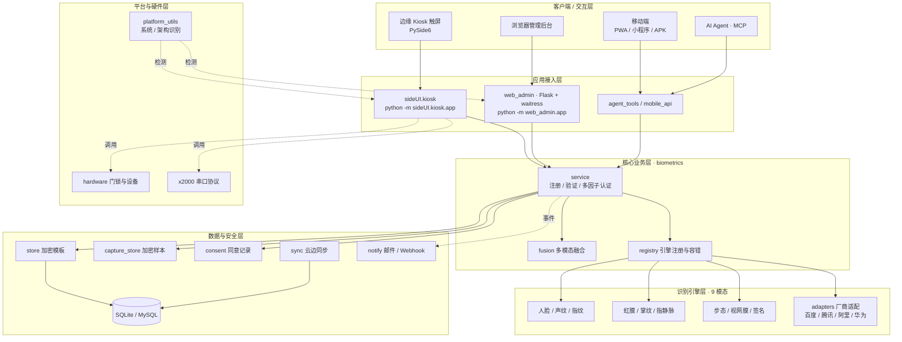
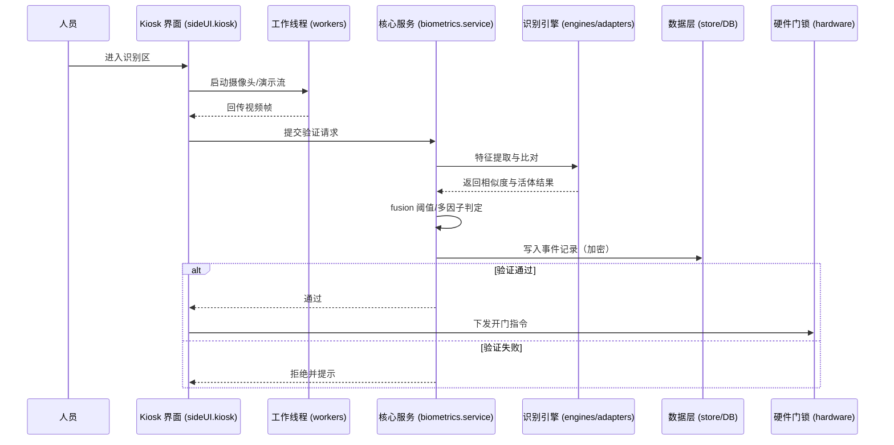

# CaosBioGuard 架构说明

> 多生物识别门禁 / 边缘安全系统。支持 **9 种生物模态**：人脸、声纹、指纹、虹膜、掌纹、指静脉、步态、视网膜、签名。
> 本文档描述系统分层、模块职责、数据流与部署形态，并配套可视化架构图。

## 1. 总体分层架构

系统采用「多端接入 → 统一核心服务 → 可插拔引擎 → 平台与硬件 → 安全数据」的分层结构。所有端最终都只调用同一个核心服务层，避免各端重复实现识别与质量门控逻辑。

> 上图由 `scripts/generate_architecture_diagram.py` 生成，修改后重新运行该脚本即可更新；下方为可在 Markdown 中直接编辑的 Mermaid 源图。

## 2. 一次识别的数据流

以边缘 Kiosk 的人脸验证为例，说明一次完整请求在各层之间的流转。

## 3. 三个运行入口

| 入口 | 命令 | 技术栈 | 运行位置 |
|---|---|---|---|
| 边缘 Kiosk | `python -m sideUI.kiosk.app` | PySide6 | 现场门禁终端 |
| Web 管理后台 | `python -m web_admin.app` | Flask + waitress | 服务器 / 上位机 |
| 核心引擎 | 被前两者调用，不独立运行 | ONNX / InsightFace 等 | 同上 |

## 4. 模块职责

### 4.1 核心业务

- `biometrics/service.py`：多模态业务服务层，统一提供注册、验证、多因子认证，是各端唯一入口。
- `biometrics/registry.py`：生物特征注册器，管理 9 个模态引擎，负责可用性探测与单引擎故障容错。
- `biometrics/fusion.py`：多模态分数融合，支持加权（weighted）、任一通过（any）、全部通过（all），对应不同安全等级。
- `biometrics/liveness.py`：活体检测。
- `biometrics/store.py`：生物特征模板加密存储，强制加密、禁止明文写入。
- `biometrics/capture_store.py`：原始采集样本加密落盘，每个特征保留「当前 + 上一版」两个版本。
- `biometrics/sync.py`：云边同步，本地 Outbox 排队、HMAC-SHA256 防篡改、幂等键去重、断网指数退避重传。
- `biometrics/consent.py`：生物识别单独同意 / 撤回记录（合规）。
- `biometrics/engines/`：9 个模态的具体识别引擎。
- `biometrics/adapters/`：厂商 SDK 适配层，把不同厂商接口统一为内部标准。
- `biometrics/plugins/`：引擎插件的加载、打包、清单与模板导入。

### 4.2 边缘端

- `sideUI/kiosk/`：当前正式 Kiosk 架构。`app.py` 主壳（顶栏 + 导航 + 5 页面 + 线程编排）、`workers.py` 摄像头/推理/演示流线程、`data.py` 本地数据、`pages/` 识别/注册/多模态/记录/管理 5 个页面。
- `ui_kit/`：PySide6 自定义控件库与主题（含跨平台字体适配）。
- `hardware/`：硬件抽象层，统一管理门锁、串口等设备。
- `x2000/`：X2000 硬件串口通信协议栈（帧、传输、客户端、常量、异常）。

### 4.3 服务端与对外接口

- `web_admin/`：Flask 管理后台，含生物识别 API、移动端 API、20 个后台页面与静态资源；初始管理员密码随机生成。
- `agent_tools/`：AI Agent 工具层，提供 JSON Schema 工具清单与 MCP（Model Context Protocol）接口。
- `notify/`：通知中心，内置邮件与 Webhook 两个渠道。
- `mobile/`：移动端，含 PWA、小程序与 Capacitor 打包的 Android APK 工程。

### 4.4 插件与扩展

- `plugins/available/`：系统内置可用插件（如百度人脸插件）。
- `custom_plugins/`：自定义插件挂载目录。
- `vendor_wrappers/`：厂商 SDK 的原生 C++ 封装源码。
- `registry/`：通用插件注册框架，提供注册器、注册中心与自动发现能力。

### 4.5 平台与工程支撑

- `platform_utils.py`：跨平台检测，识别操作系统、CPU 架构、是否打包/ARM，并提供各平台默认摄像头后端、串口名、资源路径，兼容 PyInstaller。
- `requirements/`：按角色拆分的依赖清单（edge / web / build）。
- `scripts/`：一键安装脚本（Windows `.ps1` / Linux `.sh`），自动识别平台架构。
- `deploy/`：Docker 部署（边缘 / Web 镜像、MySQL 初始化）。
- `packaging/`：PyInstaller 与 Windows Inno 打包脚本。
- `tests/`：覆盖各模块的测试套件（共 73 个用例）。
- `docs/`：项目文档；`docs/reports/` 存放不入库的评估报告。

## 5. 跨平台策略

系统在 Windows 与 Linux 上均可运行，由 `platform_utils.py` 自动识别环境并选择对应分支，无需手工切换：

- 摄像头后端：Windows 使用 DSHOW，Linux 使用 V4L2。
- 串口默认值：Windows 为 `COM3`，Linux 自动探测 `/dev/ttyUSB*`。
- 字体：按平台候选字体与跨平台 QSS 字体族适配。
- 资源路径：兼容 PyInstaller 打包后的 `_MEIPASS` 目录与 ARM 架构。
- 无摄像头 / 无模型时自动降级内置演示流，保证界面与交互可完整验收。

## 6. 部署形态

`deployment.py` 用三个正交维度描述部署，并做一致性与风险校验：

- 运行模式：`offline`（离线）/ `online`（在线）。
- 网络范围：`lan`（局域网）/ `public`（公网）。
- 拓扑结构：`integrated`（服务边缘集成）/ `separated`（服务边缘分离）。

容器化部署通过 `docker-compose.yml` 与 `deploy/` 下的 Dockerfile 完成；桌面端通过 `packaging/` 生成可执行程序与安装包。
